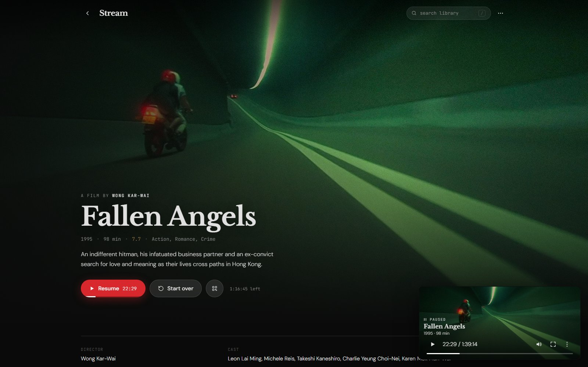

# stream-videos

A personal video streaming server: one Go binary, running as a Windows
service, serving a local media library (LAN, direct-play, never transcoded)
and a cloud library (Cloudflare R2, HLS-transcoded via ffmpeg) behind a
single-user login. Everything — server, HTML/CSS/JS, templates — lives in
[main.go](main.go).



There is also a native Windows client — see [windows/README.md](windows/README.md).

## Running it

```
stream setup       # interactive: sets the login password, R2/TMDB/etc keys in config.json
stream install      # registers the Windows service (run as Administrator)
net start stream    # or: Start-Service stream
stream uninstall     # removes the service (run as Administrator)
stream serve         # run in the foreground instead of as a service, for local testing
```

`config.json` sits next to the executable and is never committed (see
`.gitignore`) — it holds the login password hash, R2 credentials, the TMDB
API key, and local paths (library folders, watch folder, ffmpeg/yt-dlp
binaries).

### Deploying a new build

The service holds its binary open while running, so a rebuild has to stop the
service first:

```powershell
go build -o stream.new.exe .
# stop the service, swap stream.exe, restart it (needs elevation) — see
# swap.ps1 pattern used throughout this project's history for the exact
# stop/copy/poll/restart sequence.
```

## What it does

- **Local library** — walks the configured folders (`local_library_folders`
  in config.json), serves video files directly over the LAN with range
  support, no transcoding. TMDB + a local LLM identify each file (title,
  year, season/episode) and the result is cached in `local_meta.json`, keyed
  by the file's path so re-downloads and renames still resolve correctly.
- **Cloud library** — files uploaded to R2 get ffmpeg-transcoded to HLS in
  the background, with per-file processing state polled by the client.
- **Audio/subtitle enforcement** — every local file is probed once
  (`AudioCheckVer`, bumped to force a re-check) and, if needed, remuxed
  (stream copy, no re-encode) so an English audio and subtitle track are both
  physically first and flagged default — the two signals real playback
  hardware actually looks at. A title whose TMDB `original_language` is
  Japanese keeps its Japanese track instead of being forced to an English
  dub; English subtitles are still the default either way. A file that's
  still mid-download (see `isFileStable`/`looksIncomplete`) is left alone
  until its size and header both settle, rather than being probed prematurely
  or marked permanently checked on a false failure.
- **Extras** — a movie's bonus material and a season's own Featurettes
  folder are both recognized (by hand for a movie via `local_meta.json`'s
  `is_extra`/`main_key`; automatically for a TV season, from the folder's own
  naming — see `markShowFeaturettes`) and shown under that movie or that
  season rather than cluttering the wall as unidentified files.
- **PGS subtitle OCR** — a Blu-ray rip's subtitle track is usually a bitmap
  (PGS), not text, so ffmpeg can't just re-encode it the way it can a real
  SRT/ASS stream (see `textSubtitleCodecs`). When there's no text subtitle to
  fall back to, [PgsToSrt](https://github.com/Tentacule/PgsToSrt) OCRs the
  PGS track into a real WebVTT once per file (`PGSOCRVer`, gated the same way
  as the audio check), so it plays back through the same `<track>` element
  and CC toggle as everything else. Needs `pgstosrt_path` set in config.json,
  the .NET 8.0 runtime installed, and an `eng.traineddata` file (from
  [tessdata_best](https://github.com/tesseract-ocr/tessdata_best)) in a
  `tessdata` folder next to PgsToSrt.exe; unset, this is skipped entirely.
- **Torrent search/download** — Jackett search, qBittorrent download,
  optional auto-sort of finished downloads into the library.
- **Music videos** — yt-dlp-based search and download, artist/title parsed
  from the filename rather than an external lookup (see memory: no iTunes
  lookup).
- **Watch history & resume** — keyed by content identity (TMDB id, or
  normalized filename for unmatched files) rather than file path, so
  re-downloaded or renamed files still resume from where you left off.
- **Playlists** — user-created, composed cover art from member thumbnails.
- **FileDrop** — shares a session cookie with a configured external
  FileDrop instance so both apps see the same logged-in session.

## Data files

`local_meta.json` is tracked in git — it's the enrichment cache, and some of
its entries carry hand-corrected fields (title, tmdb id, season/episode,
is_extra/main_key) that a bulk enrichment pass must never overwrite; any
schema-changing or bulk-touching change to it should be backed up first (see
`metadata-backups/`, itself gitignored). `playlists.json`, `watch_history.json`
and `playback_progress.json` are local runtime state and are not committed.
