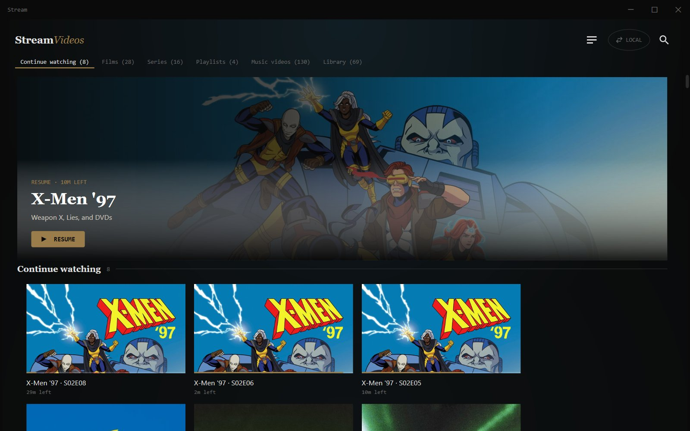

# Stream — Windows player

A native Windows client for the `stream-videos` server, built to look and
feel like the web UI's own local site — same hero banner, section rails,
card art, search and scrollbar styling — but backed by
[libVLC](https://www.videolan.org/vlc/libvlc.html) instead of a browser
`<video>` element. Browsers only decode a small, fixed audio codec set
(AAC/Opus/Vorbis/MP3) in `<video>`/MSE; this library contains
AC3/EAC3/DTS/TrueHD/FLAC tracks that fall outside it. libVLC bundles real
libav decoders, so those codecs just decode, no server-side remuxing
gymnastics required.



It is a **client only**. All library scanning, TMDB enrichment, and the
transcode pipeline stay on the Go server (`main.go`) exactly as they are
today; this app just talks to the same HTTP API the web frontend already
uses, plus the LAN-only `/local/...` endpoints for the local library.

## What's implemented

- **Login & session** — password auth against the server's existing
  `POST /login`, with the session cookie reused for every API call.
  Credentials are DPAPI-encrypted and saved locally (tied to the Windows
  account), so the app silently re-authenticates instead of prompting for a
  password every launch.
- **Two sources, one toggle** — Online (the CDN-backed catalog, `GET
  /files`) and Local (the LAN-only library, `GET /local/files`) behind a
  single alternating toggle rather than two separate pills. The last-used
  source is remembered across launches. If Local is picked while off the
  server's LAN, the failure is caught and surfaced as an actionable banner
  ("switch to Online") instead of a generic error, and whatever was on
  screen before stays up rather than being cleared.
- **The wall** — a hero banner (whatever's most likely relevant right now:
  the top continue-watching item, or the first thing in the catalog) sized
  and gradiented to match the web's actual `.hero`, followed by
  scroll-spied section rails — Continue watching (capped at 7), Films,
  Series, Playlists, Music videos, Library — each with a jump-tag at the
  top that tracks scroll position, mirroring `railAnchors`/`buildWall` in
  the web frontend. Poster cards (2:3) are used for Films/Series; wide
  frame-still cards (16:9) for everything else, matching the web's own
  `.pc-cover`/`.cw-shot` split so nothing gets forced into the wrong aspect
  ratio.
- **Playback** — an embedded libVLC `VideoView` inset over the browse view
  (not a full-window takeover) with a gradient still visible beside it.
  HLS items play their `master.m3u8`; direct-play and local items resolve
  through the server's redirect/`/local/file` endpoints. Full VLC-backed
  controls: audio track, subtitle track, playback speed, and aspect ratio,
  all exposed since libVLC already has them available, not just a bare
  play/pause.
- **Subtitles** — passed straight to libVLC (`subtitle_url` for cloud
  items, `/local/subtitle` for local ones).
- **Resume/watch-history sync** — reads and writes `/api/progress`, the
  same endpoint the web player uses, so progress carries over between web
  and native.
- **Playlists & queue** — create/add/remove/delete playlists against the
  server's existing playlist API; a right-side queue drawer (with its own
  close button) for building a play-next list during a session.
- **Search** — a full-screen overlay matching the web's own search
  experience, filtering the wall by title as you type.
- **Custom title bar** — `WindowChrome`-based, dark-themed to match the
  rest of the app, with real Aero-snap/drag/resize behavior intact.
- **Auto-update check** — polls `GET /windows-app/version` on launch and
  shows a dismissible banner with a download link when a newer build is
  published; doesn't install anything itself.
- **Installer** — an Inno Setup script (`StreamVideosPlayer.iss`) producing
  a proper Start Menu / uninstaller-backed setup, icon included. Not
  required to test locally — a self-contained `dotnet publish` output runs
  standalone.

## How auth works

No changes were needed on the server side for the cloud path. `GET
/file?key=...` already requires a valid session cookie, but it doesn't
serve the video bytes itself — it 302-redirects to the public R2/CDN URL
(`r2_public_url` + key) once the caller is authenticated (see `handleFile`
in `main.go`). So this app:

1. Logs in once with `HttpClient` + a `CookieContainer` to get a session
   cookie, used for all JSON API calls (`/files`, `/local/files`,
   `/api/progress`, playlists).
2. For a direct-play cloud item, makes that same authenticated request to
   `/file?key=...` with redirects disabled, reads the `Location` header,
   and hands **that** (public, unauthenticated) CDN URL straight to
   libVLC.
3. For an HLS item, `hls_base` from `/files` is already a full public CDN
   URL — no redirect step needed.
4. For a local item, `/local/file`, `/local/thumbnail`, and
   `/local/subtitle` are LAN-only (`localOnly()` middleware in `main.go`)
   and served straight from the session-authenticated request — no
   redirect involved, since there's no CDN in front of the local library.

libVLC itself never needs to hold a cookie or a token for the cloud path;
it only ever opens plain public URLs, the same way the CDN already serves
the web player.

## Build & run

Requires the [.NET 10 SDK](https://dotnet.microsoft.com/download) and
Windows 10/11 x64 (libVLC's Windows binaries are pulled in automatically
via NuGet on first restore — you'll need internet access for that first
build).

```
cd windows/StreamVideosPlayer
dotnet restore
dotnet run
```

On first launch, enter the server's URL (e.g. `https://your-tunnel-domain`
or `http://<lan-ip>:5746`) and the same password used for the web login.

## Packaging an installer

```
cd windows/StreamVideosPlayer
dotnet publish -c Release -r win-x64 --self-contained true -o publish
cd ..
iscc StreamVideosPlayer.iss
```

Produces `windows/Output/StreamVideosPlayer-Setup.exe`. Requires
[Inno Setup](https://jrsoftware.org/isinfo.php). Bump `MyAppVersion` in
`StreamVideosPlayer.iss` (and `<Version>` in the `.csproj`) alongside
`data/windows_app_version.json` on the server when cutting a release, so
the in-app update check picks it up.

## Project layout

```
StreamVideosPlayer/
  App.xaml(.cs)               shared styles/templates (palette, card templates,
                               scrollbar/context-menu theming); startup: LibVLC
                               init, silent re-login, picks Login/Main window
  LoginWindow.xaml(.cs)        server URL + password entry
  MainWindow.xaml(.cs)         hero + section-rail wall, embedded VideoView,
                               transport controls, search overlay, queue drawer
  PlaylistDetailWindow.xaml(.cs)  one playlist's resolved items
  AddToPlaylistWindow.xaml(.cs)   create/choose a playlist to add an item to
  app.ico                      app icon (derived from stream-logo.svg)
  StreamVideosPlayer.iss       Inno Setup installer script
  Services/
    ServerClient.cs      HTTP calls to the Go server (login, /files,
                          /local/files, /file, /local/file, /api/progress,
                          playlists, /windows-app/version)
    CredentialStore.cs   DPAPI-encrypted local credential storage
    AppSettings.cs       plain-JSON local UI prefs (last-used source)
    FileEntry.cs         DTO for GET /files and /local/files (mirrors
                          fileEntry in main.go)
    PlaylistDto.cs        DTO for the playlist API
    ProgressModels.cs    DTOs for GET/POST /api/progress
    UpdateInfo.cs         DTO for GET /windows-app/version
```
